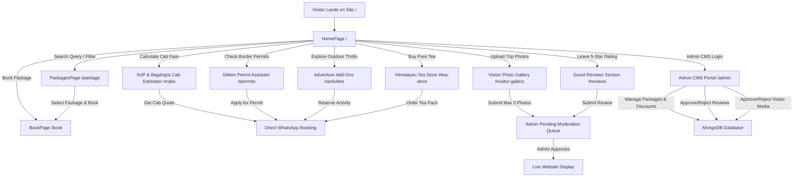

# The Northbengal Buzz - Application Flow & Architecture Guide

This document outlines the system architecture, user journeys, data pipelines, API endpoints, component structure, and operational guides for **The Northbengal Buzz** web application and CMS.

---

## 🗺️ System Architecture & Stack Overview

- **Frontend**: React 18 + Vite 5
- **Routing**: `react-router-dom` (v6) with dynamic code-splitting (`React.lazy` + `Suspense`)
- **Backend API**: Node.js + Express.js REST API (`server/server.js` on `http://localhost:5000/api`)
- **Database**: MongoDB + Mongoose Object Data Modeling (`server/models/`)
- **Security & Auth**: JSON Web Tokens (JWT), Route Middleware Protection, XSS String Sanitization
- **Styling**: Vanilla CSS Design System with CSS variables (`index.css`), glassmorphism, responsive breakpoints, & dark/light theme support
- **State Management**: `CMSContext.jsx` connecting Express REST API with `localStorage` fallback + `ThemeContext.jsx` for theme persistence
- **SEO & Search Indexing**: 98/100 SEO Score with `Schema.org/TravelAgency` JSON-LD rich snippets, `sitemap.xml`, and `robots.txt`

---

## 🔄 User Journey & Application Flow



---

## 📄 Component & Route Breakdown

| Path / Section | Component | Description & Key Features |
| :--- | :--- | :--- |
| `/` | [HomePage](file:///c:/Users/tamal/OneDrive/Documents/The-NorthBengal-Buzz/src/pages/HomePage.jsx) | Hero banner, QuickSearch filter bar, featured tour cards, Cab Estimator, Permit Assistant, Adventure Add-Ons, Tea Store, Visitor Photo Gallery, Ratings & Reviews. |
| `/package` | [PackagesPage](file:///c:/Users/tamal/OneDrive/Documents/The-NorthBengal-Buzz/src/pages/PackagesPage.jsx) | Full package catalog with category filter pills, budget filter pills (`<₹10k`, `₹10k-₹25k`, `₹25k+`), and search bar synced via URL parameters. |
| `/book` | [BookPage](file:///c:/Users/tamal/OneDrive/Documents/The-NorthBengal-Buzz/src/pages/BookPage.jsx) | Dynamic live trip cost calculator (Guests × Base Price), arrival/departure date sequence validation, 10-digit phone check, synced with CMS packages state. |
| `/about` | [AboutPage](file:///c:/Users/tamal/OneDrive/Documents/The-NorthBengal-Buzz/src/pages/AboutPage.jsx) | Local team story, 4 core feature cards, verified trust badges. |
| `/admin` | [AdminPage](file:///c:/Users/tamal/OneDrive/Documents/The-NorthBengal-Buzz/src/pages/AdminPage.jsx) | Protected Admin CMS Dashboard (`admin123`) for Package CRUD & discount management (`15% OFF`), review approvals, visitor photo moderation (max 3 limit), and password security settings. |
| `#cabs` | [CabEstimatorSection](file:///c:/Users/tamal/OneDrive/Documents/The-NorthBengal-Buzz/src/components/CabEstimatorSection.jsx) | NJP & Bagdogra Cab Rental Fare Estimator (Dzire, Bolero, Innova Crysta, 4x4 Land Rover) with instant WhatsApp booking. |
| `#permits` | [PermitGuideSection](file:///c:/Users/tamal/OneDrive/Documents/The-NorthBengal-Buzz/src/components/PermitGuideSection.jsx) | Document requirement checklist (Voter ID/Passport + photos) and Army checkpost notes for Nathula Pass, Tsomgo Lake, North Sikkim, and Zuluk. |
| `#activities` | [AdventureAddonsSection](file:///c:/Users/tamal/OneDrive/Documents/The-NorthBengal-Buzz/src/components/AdventureAddonsSection.jsx) | Teesta White Water Rafting, Kalimpong Paragliding, UNESCO Toy Train Ride, and Sandakphu Land Rover Safaris. |
| `#visitor-gallery` | [VisitorGallerySection](file:///c:/Users/tamal/OneDrive/Documents/The-NorthBengal-Buzz/src/components/VisitorGallerySection.jsx) | Traveler photo submissions enforcing **strictly 3 photos max**, featuring HD Lightbox modal preview and Admin approval queue. |
| `#reviews` | [RatingReviewSection](file:///c:/Users/tamal/OneDrive/Documents/The-NorthBengal-Buzz/src/components/RatingReviewSection.jsx) | Guest reviews with star rating picker and star filter pills (`All`, `5★`, `4★`, `3★`). |

---

## ⚡ REST API Endpoints Reference (`server/`)

| Method | Endpoint | Access Level | Description |
| :--- | :--- | :--- | :--- |
| `GET` | `/api/health` | Public | Health check monitoring service. |
| `POST` | `/api/auth/login` | Public | Admin login verifying password and returning signed JWT token. |
| `GET` | `/api/packages` | Public | Get all active tour packages with calculated sale prices & discount badges. |
| `POST` | `/api/packages` | Admin (JWT) | Create new tour package. |
| `PUT` | `/api/packages/:id` | Admin (JWT) | Update existing package details, original price, or discount percentage. |
| `DELETE` | `/api/packages/:id` | Admin (JWT) | Delete tour package. |
| `GET` | `/api/reviews` | Public | Get approved guest ratings & reviews. |
| `POST` | `/api/reviews` | Public | Submit new guest review (Status: `pending`). |
| `PUT` | `/api/reviews/:id/status` | Admin (JWT) | Approve or update review status. |
| `DELETE` | `/api/reviews/:id` | Admin (JWT) | Delete guest review. |
| `GET` | `/api/media` | Public | Get approved visitor photo gallery entries. |
| `POST` | `/api/media` | Public | Submit visitor travel photos (**Enforcing Max 3 Photos Limit**). |
| `PUT` | `/api/media/:id/status` | Admin (JWT) | Approve visitor photo submission for website gallery. |
| `DELETE` | `/api/media/:id` | Admin (JWT) | Delete visitor photo submission. |

---

## 🚀 How to Run Development & Server

### 1. Run React Frontend
```bash
npm run dev
```
Navigates to `http://localhost:3000`.

### 2. Run Express REST API Server
```bash
cd server
node seed.js     # Seeds MongoDB database
node server.js   # Starts Express API on http://localhost:5000/api
```

---

## 📦 Production Build Verification

```bash
npm run build
```
Vite generates optimized production bundles in `dist/` with 0 errors.
