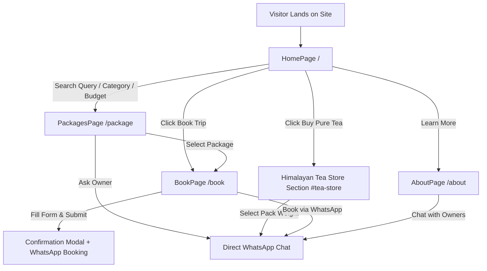

# The Northbengal Buzz - Application Flow & Development Guide

This document outlines the architecture, page flows, data pipelines, component structure, and instructions for running and deploying **The Northbengal Buzz** web application.

---

## 🗺️ System Architecture & Stack Overview

- **Framework**: React 18 + Vite 5
- **Routing**: `react-router-dom` (v6) with dynamic code-splitting (`React.lazy` + `Suspense`)
- **Styling**: Vanilla CSS Design System with CSS variables (`index.css`), responsive layouts, glassmorphism, & dark/light theme support
- **State Management**: React Context (`ThemeContext`) + URL search parameters (`useSearchParams`) for reactive catalog filtering
- **Configuration**: Centralized site metadata and WhatsApp URL helper (`src/config/siteConfig.js`)
- **Icons & Fonts**: FontAwesome v6 & Google Fonts (`Outfit`, `Playfair Display`)

---

## 🔄 User Journey & Navigation Flow



---

## 📄 Component & Route Breakdown

| Path | Component | Description & Key Features |
| :--- | :--- | :--- |
| `/` | [HomePage](file:///c:/Users/tamal/OneDrive/Documents/The-NorthBengal-Buzz/src/pages/HomePage.jsx) | Hero banner, QuickSearch filter bar, category-filtered tour cards, weight-pack tea selector grid, direct WhatsApp callout banner. |
| `/package` | [PackagesPage](file:///c:/Users/tamal/OneDrive/Documents/The-NorthBengal-Buzz/src/pages/PackagesPage.jsx) | Search by destination keyword, Category filter pills, Budget range filter pills (`<₹10k`, `₹10k-₹25k`, `₹25k+`), synced via URL parameters. |
| `/book` | [BookPage](file:///c:/Users/tamal/OneDrive/Documents/The-NorthBengal-Buzz/src/pages/BookPage.jsx) | Dynamic live trip price calculator (Guests × Base Price), stay duration calculator, 10-digit mobile number format validation, date sequence verification, booking modal. |
| `/about` | [AboutPage](file:///c:/Users/tamal/OneDrive/Documents/The-NorthBengal-Buzz/src/pages/AboutPage.jsx) | Story of local team, 4 core feature cards, verified guest feedback grid with star ratings. |
| `*` | [NotFound](file:///c:/Users/tamal/OneDrive/Documents/The-NorthBengal-Buzz/src/pages/NotFound.jsx) | Clean 404 page with navigation fallback back to home. |

---

## ⚡ Data & Global State Flow

```
[ packagesData.js / teaProductsData.js ] ──> Data Sources
                                                  │
                                                  ▼
[ siteConfig.js ] ─────────────────────────> [ Components & Pages ]
(Centralized WhatsApp & Phone Config)              │
                                                  ▼
[ ThemeContext.jsx ] ──────────────────────> Applies data-theme="dark|light" to <html>
```

1. **`siteConfig.js`**: Centralized single source of truth for business contact numbers, email, social media links, and WhatsApp URL generation (`SITE_CONFIG.getWhatsAppUrl(msg)`).
2. **`ThemeContext.jsx`**: Handles theme toggle state, persists preference in `localStorage`, and updates `data-theme` on `document.documentElement`.
3. **`QuickSearch.jsx` & `PackagesPage.jsx`**: Uses React Router's `useSearchParams` so filter combinations can be shared or bookmarked directly via URL.

---

## 🚀 Process How to Run & Build

### Prerequisites
Make sure you have **Node.js** (v18.0.0 or higher) and **npm** installed on your system.

```bash
node -v
npm -v
```

### 1. Clone & Install Dependencies
Navigate to the project directory and install required npm packages:

```bash
cd The-NorthBengal-Buzz
npm install
```

### 2. Run Development Server
Start the local development server with hot-module replacement (HMR):

```bash
npm run dev
```
Open your browser and navigate to `http://localhost:3000`.

### 3. Run Code Quality & Lint Checks
Run ESLint to verify code quality and rule compliance:

```bash
npm run lint
```

### 4. Build for Production
Generate optimized production bundle in the `dist/` directory:

```bash
npm run build
```

### 5. Preview Production Build Locally
Preview the production build locally before deploying:

```bash
npm run preview
```

---

## 🌐 Deployment (Netlify & Single-Page Routing)

The repository includes a pre-configured `netlify.toml` file with redirect rules to handle client-side routing (`/* -> /index.html` status 200) and security headers.

### Deployment Command:
- **Build Command**: `npm run build`
- **Publish Directory**: `dist`
